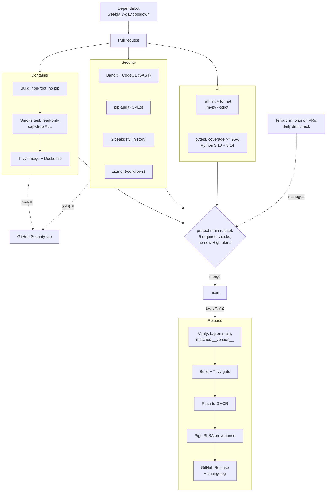

# pwcheck

[](https://github.com/DGUY1-wilm/pwcheck/actions/workflows/ci.yml)
[](https://github.com/DGUY1-wilm/pwcheck/actions/workflows/security.yml)
[](https://github.com/DGUY1-wilm/pwcheck/actions/workflows/container.yml)
[](https://github.com/DGUY1-wilm/pwcheck/actions/workflows/terraform.yml)
[](https://github.com/DGUY1-wilm/pwcheck/releases/latest)
[](LICENSE)

A command-line password strength checker that scores passwords by **entropy** and checks whether they've appeared in known data breaches using the **HaveIBeenPwned k-anonymity API**, without ever sending your password (or its full hash) anywhere.

Standard library only. No runtime dependencies.

- **New to the command line, or want to build a pipeline like this yourself?** See [GETTING_STARTED.md](GETTING_STARTED.md): part 1 runs pwcheck, part 2 is a plain-language walkthrough of all six build stages.
- **How AI was used:** this project was built with an AI assistant; [AI_USAGE.md](AI_USAGE.md) documents who did what, including mistakes.

The project is also a working **DevSecOps pipeline**: every change is linted, type-checked, tested, scanned by six security tools and container-scanned before it can merge, and releases are published as signed, verifiable container images. See [CI/CD & Security](#cicd--security).

## Install & run

**Container (no Python needed):**

```bash
docker run --rm -it ghcr.io/dguy1-wilm/pwcheck:latest
```

**From source:**

```bash
git clone https://github.com/DGUY1-wilm/pwcheck.git
cd pwcheck
pip install -e .
pwcheck                 # prompts for a password (hidden input)
```

Other modes:

```bash
echo 'hunter2' | pwcheck --stdin         # read from stdin
pwcheck --no-network                     # entropy only, fully offline
pwcheck --wordlist rockyou-top100k.txt   # add a bigger common-password list
```

Exit codes: `0` ok, `1` weak, `2` found in a breach (handy for scripts / CI).

## Example output

```
Password: ********

Strength : [####----------------] Very weak
Entropy  : 10.0 bits (pool size 26, length 8)
Crack time (offline, fast hash): instantly
  ! This is a very common password.
  ! Shorter than 12 characters; length matters most.

Breach check: PWNED, seen 9,545,824 times in known breaches. Do not use it.
```

## How it works

### 1. Entropy scoring (`entropy.py`)
- Estimate the **character pool** (lowercase 26, uppercase 26, digits 10, symbols 32, ...).
- `entropy = length x log2(pool)`
- Subtract penalties for repeated characters and alphabet/keyboard/number sequences.
- Cap known-common passwords at ~10 bits.
- Map bits to a 0-4 score and an estimated offline crack time (assumes 10^10 guesses/sec, average case = half the keyspace).

### 2. Breach lookup with k-anonymity (`hibp.py`)

```
password --SHA-1--> 5BAA61E4C9B93F3F0682250B6CF8331B7EE68FD8
                    \___/ \_______________________________/
                   prefix              suffix
                  (sent to API)     (never leaves your machine)
```

1. Hash locally with SHA-1.
2. Send only the **first 5 hex characters** to `api.pwnedpasswords.com/range/{prefix}`.
3. The API returns every breached-hash suffix with that prefix (hundreds of candidates).
4. Compare your suffix **locally**.

The `Add-Padding` header is enabled so response size can't hint at which bucket you hit.

## Threat model

| Concern | Mitigation |
|---|---|
| Password leaked to the API | Only a 5-char hash prefix is sent; the API can't tell which of ~800 suffixes is yours |
| Password in shell history / `ps` | Not accepted as a CLI argument; read via `getpass` or stdin |
| Response-size side channel | `Add-Padding: true` |
| Network failure | Degrades gracefully; entropy score still shown |

**Limitations:**
- Entropy estimates assume random selection. Human-chosen passwords like `Summer2026!` score higher than they deserve. Production tools (e.g. zxcvbn) model dictionary words, leetspeak, dates, and names.
- SHA-1 is used only because the HIBP API requires it, not for any security purpose.
- The attacker-speed assumption is a rough model, not a guarantee.
- A malicious or compromised API endpoint could still observe your IP and the prefix.

## CI/CD & Security



| Workflow | Runs on | What it does |
|---|---|---|
| [`ci.yml`](.github/workflows/ci.yml) | PRs, pushes to main | Ruff lint + format, mypy strict, pytest with a 95% branch-coverage gate on Python 3.10 and 3.14 |
| [`security.yml`](.github/workflows/security.yml) | PRs, pushes, weekly | Bandit and CodeQL (SAST), pip-audit (known CVEs), Gitleaks (secrets in full history), zizmor (workflow security); results uploaded as SARIF |
| [`container.yml`](.github/workflows/container.yml) | PRs, pushes, weekly | Builds the image, smoke-tests it under production restrictions, Trivy scans the Dockerfile and image, fails on fixable HIGH/CRITICAL |
| [`release.yml`](.github/workflows/release.yml) | `vX.Y.Z` tags | Verifies the tag, scans before pushing to GHCR, attests build provenance, publishes a GitHub Release with a generated changelog |
| [`terraform.yml`](.github/workflows/terraform.yml) | PRs touching `infra/`, daily | `fmt` / `validate` / `plan` for the repo's own settings; the daily run fails on drift |

### Security design

- **Least-privilege tokens.** Every workflow defaults to read-only (`release.yml` to no permissions at all); each job requests only what it needs, such as `packages: write` for the one job that pushes images. Releases authenticate with the per-run `GITHUB_TOKEN`, so no long-lived registry secret exists.
- **Supply chain.** All actions are pinned to commit SHAs; Gitleaks and Trivy binaries are SHA-256 verified before they run; Python tools are pinned exactly; the base image is pinned by digest; the Terraform provider by `.terraform.lock.hcl`. Dependabot keeps all of it current, with a 7-day cooldown on new releases.
- **Hardened container.** Multi-stage build on a slim base, runs as UID 10001, pip removed, smoke-tested with `--read-only --cap-drop ALL --security-opt no-new-privileges`.
- **Verifiable releases.** Images and Python packages carry signed SLSA build provenance:
  ```bash
  gh attestation verify oci://ghcr.io/dguy1-wilm/pwcheck:0.2.0 --repo DGUY1-wilm/pwcheck
  ```
- **Protected history.** `main` requires a PR, all 9 checks and no new High+ code-scanning alerts; no one can force-push or bypass. Release tags can't be moved or deleted. GitHub secret scanning with push protection is on.
- **Settings as code.** The rulesets and Actions permissions live in [`infra/github`](infra/github) (Terraform). A daily plan detects any change made by hand in the UI.

Found a vulnerability? See [SECURITY.md](SECURITY.md).

### Run the checks locally

```bash
pip install -e ".[dev,security]"
ruff check . && ruff format --check . && mypy && pytest
bandit -r src
pip-audit --skip-editable
zizmor .github/
```

Tests never touch the real API. `pwned_count` takes an injectable `fetch` function, and `fetch_range` is tested against a fake `urlopen`. Tests assert that only the 5-character prefix is ever sent, and that `fetch_range` rejects anything that isn't exactly 5 hex characters.


